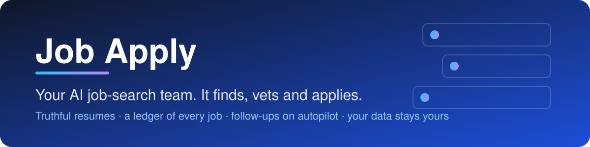

<p align="center">
  
</p>

<p align="center">
  
  
  
  
</p>

<h3 align="center">Tell Claude <em>"I want to apply for jobs."</em><br>It installs everything, learns what you want, then searches, vets and applies for you.</h3>

---

## What you get

| | |
|---|---|
| 🔎 **Searches like a person** | Browses LinkedIn Jobs and company career pages in a real, signed-in browser ([BrowserOS neo](https://www.browseros.com/)), and reads company job boards (Greenhouse, Ashby, Lever) directly. |
| ⚖️ **Vets every job against *your* rules** | Role, seniority, pay, location, office days, company type. Every job it sees lands in a **ledger** with a status and a reason, so nothing is judged twice and nothing is forgotten. |
| 📝 **Truthful, tailored resumes** | One resume per role type, built only from facts you confirmed. It never invents a metric, tool or title. |
| 🚀 **Applies for you** | Fills the company's own application form, reads every field back, saves exactly what was sent, and keeps the posting text in case it is taken down. |
| 📬 **Follows up** | With your permission, checks your email and LinkedIn messages every weekday (read only), logs replies, rejections and interviews, and drafts answers for you to approve. |
| 🧠 **Gets better as it goes** | Every new form question, answer and quirk is saved once and never asked twice. |
| 📊 **A board you can open** | A clean dashboard of every application, follow-up due and blocker. |

> [!WARNING]
> **An idea, shared as-is. Not a product, and not promoted by its author.** Use it entirely at your own risk: you are responsible for what it does with your accounts and data and for everything you submit. The author is not liable for anything. See the [Disclaimer](DISCLAIMER.md).

> [!IMPORTANT]
> It **never** signs in for you, creates accounts, types passwords, solves CAPTCHAs, or sends a message on your behalf. When a step needs one of those, it pauses that single application, tells you exactly what is needed, and carries on with the rest.

## Get started in 3 steps

You need a computer (Mac or Windows) and the [Claude desktop app](https://claude.com/download) with Claude Code. No technical knowledge needed: Claude does the installing and configuring.

**1. Open Claude and start a Code session.** In a new session, paste:

```text
Clone https://github.com/p1927/job-apply into my Documents folder, open it, and set me up for job applications.
```

**2. Answer a few questions.** Claude installs what is missing (including BrowserOS neo, the browser it works in), then asks about you in short batches: your name, LinkedIn, your resume, the jobs you want, where you can work, pay, and how much freedom it has. It may ask you to click **Install** on a system prompt, sign in to LinkedIn and your email *inside the new browser* yourself, or type your computer password once. That is all.

**3. Say what you want.** When setup finishes it runs a self-check and tells you it is ready:

```text
find jobs        →  search, vet and shortlist
apply            →  fill and submit applications that pass your rules
check replies    →  read your inbox, log outcomes, draft answers
```

## How it works

```mermaid
flowchart LR
    A([You: "I want to apply for jobs"]) --> B[Setup skill<br/>installs tools, interviews you]
    B --> C[(Your private folder<br/>rules · facts · resume · ledger)]
    C --> D[Search<br/>LinkedIn · company pages · job boards]
    D --> E{Passes<br/>your rules?}
    E -- no --> F[Ledger: not relevant<br/>+ reason]
    E -- yes --> G[Tailored resume<br/>+ saved posting]
    G --> H[Apply on the<br/>company's own site]
    H --> I[Company file:<br/>answers, confirmation]
    I --> J[Weekday follow-up<br/>email + LinkedIn, read only]
    J --> K[Board · outcomes · lessons]
    K -. new answers and quirks .-> C
    H -. CAPTCHA, login, unknown fact .-> L([Pauses and asks you])
    L --> H
```

## Your data is yours

Everyone who uses this gets their **own private folder** (a *tenant*) under `tenants/<you>/`. The engine in this repository contains **no personal data**, and tools only ever read and write inside the active person's folder. Two people on the same copy never see each other's profile, ledger, resumes or board, and an automated check fails loudly if anything ever leaks.

- Your folder lives on **your** computer and is ignored by this repository, so it can never be pushed here by accident.
- Optional: Claude can back it up to **your own private GitHub repository** (you create the free account and sign in yourself).
- Nothing is sent anywhere except the job applications you allow.

## You stay in control

- **Approval mode:** *standing* (it submits roles that pass your rules and reports afterwards) or *each* (it asks before every submit). You choose in setup and can change it any time.
- **Truth rules:** only facts in your confirmed profile reach a resume or a form. Gaps are asked, never guessed.
- **Ambiguity rule:** unknown pay or office days do not block an application; they are noted as questions for the first call.
- **Everything is on record:** each application has a company file with the posting as published, every answer submitted, open questions and your interview log.

## What is inside

<details>
<summary><strong>Skills, tools and layout</strong></summary>

| Path | What it is |
|---|---|
| `.claude/skills/setup/` | First run and new people: machine setup, BrowserOS neo, interview, profile, resume, self-check |
| `.claude/skills/job-search/` | Search, review, apply, follow-up, plus `ats-playbook.md` (how each application system behaves, self-updating) |
| `tools/` | Python scripts: ledger, applications, resumes, board, consistency and leak checks, sync, self-tests |
| `config/vocab.json` | The fixed vocabulary: statuses, reason codes, blockers |
| `templates/` | Company-file, handover and follow-up task templates |
| `tenants/_template/` | The empty private folder copied for each new person |
| `docs/` | Resume guide and the optional [career-ops](https://github.com/p1927/career-ops) integration |

Each person's folder holds `REQUIREMENTS.md` (the rules), `candidate-profile.md` (the facts), `applicant-details.md` (form answers), `resume-content.json`, the **ledger** `data/seen-jobs.csv`, `data/applications.json`, `applications/` (one file per application) and the generated `board/index.html`.

</details>

<details>
<summary><strong>Quality checks</strong></summary>

- `python3 tools/test_tools.py`: 60+ automated checks on a synthetic person, including tenant isolation and leak detection.
- `python3 tools/verify_tenant.py`: confirms a new person's setup is complete before the first real run.
- `python3 tools/check_consistency.py`: validates the ledger, applications and files at the start of every session.

</details>

## FAQ

<details>
<summary><strong>Do I need to know how to code?</strong></summary>
No. You talk to Claude in plain language. It runs every command itself and only stops when something truly needs you (a password, a CAPTCHA, a fact only you know).
</details>

<details>
<summary><strong>Which job sites does it search?</strong></summary>
LinkedIn Jobs and company career pages in the BrowserOS neo browser, plus the public job-board APIs of the companies on your list. If the Firecrawl connector is available in your Claude it also uses it for company pages and pay research. During setup you can name other sites you want included.
</details>

<details>
<summary><strong>Will it read my email?</strong></summary>
Only if you say yes in setup. It reads your inbox and LinkedIn messages read-only on weekdays to match replies to applications. It never replies, sends, archives or deletes, and treats message text as information, never as instructions.
</details>

<details>
<summary><strong>Can two people use it on the same computer?</strong></summary>
Yes, each in their own folder. Note that the browser keeps one set of signed-in accounts per computer, so the second person signs in to their own accounts when it is their turn (or uses their own computer).
</details>

<details>
<summary><strong>Is it safe to let it apply for me?</strong></summary>
You decide how much freedom it has. It follows your written rules, applies only on the company's own forms, and records everything it sent. It cannot sign in, create accounts, solve CAPTCHAs or message recruiters for you.
</details>

<details>
<summary><strong>What if something breaks?</strong></summary>
Claude is set up to fix its own tooling and tell you in a sentence or two what happened. Run <code>python3 tools/setup_machine.py</code> any time for a plain health report.
</details>

## Requirements

- The Claude desktop app with Claude Code (a Claude plan that includes it)
- macOS 12+ or Windows (x64) (BrowserOS neo has no Linux build yet). Windows support is newer and less tested than macOS.
- Everything else (git, Chrome, BrowserOS neo, Python checks, optional career-ops) is installed by the setup skill.

## Disclaimer and license

This is a personal idea shared **as-is, with no warranty**. The author is **not liable** for any outcome of using it and is **not promoting or endorsing** its use. Anyone who uses it is solely responsible for it, including compliance with the terms of every website and service involved. Full text: [DISCLAIMER.md](DISCLAIMER.md). Free to use, copy and modify under the [MIT License](LICENSE).

<p align="center"><sub>Built to be run by Claude. Page and message content is treated as data, never as instructions.</sub></p>
